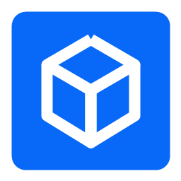
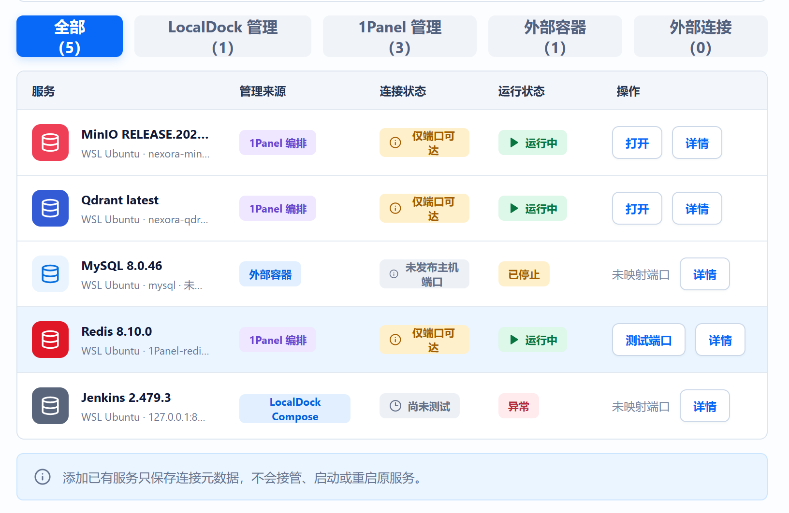
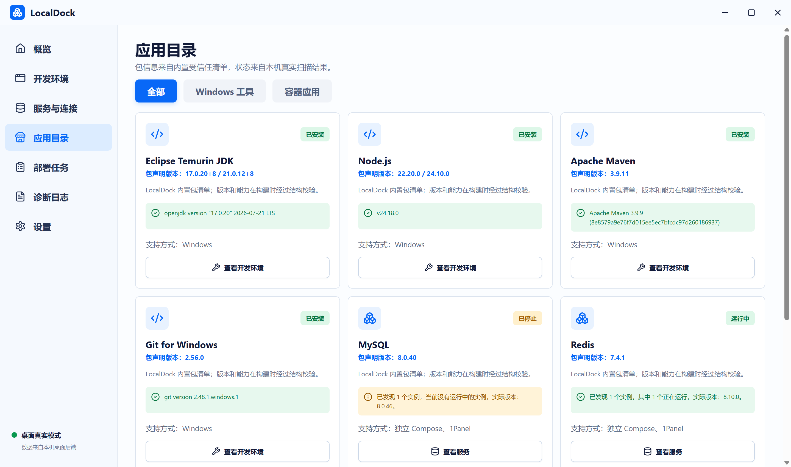
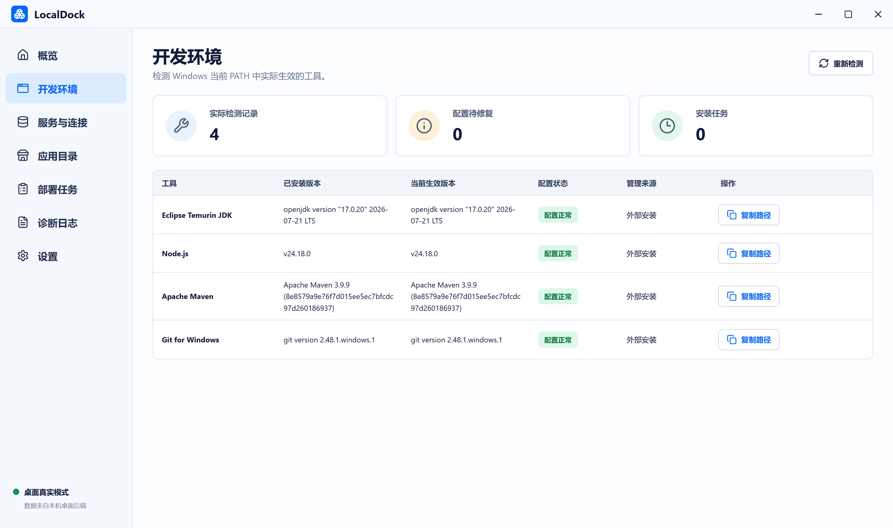

<p align="center">
  
</p>

<h1 align="center">LocalDock</h1>

<p align="center">
  面向 Windows 开发者的本地开发环境与容器服务工作台
</p>

<p align="center">
  
  
  
  
  
</p>

LocalDock 将 Windows 开发工具检测、已有服务连接和 WSL2 容器服务管理放在一个桌面应用中。它读取本机真实环境，不使用演示数据伪造安装、运行或连接状态。

> 当前项目仍处于早期开发阶段。请先阅读下方的“当前限制”，再用于重要环境。

## 界面预览

### 服务发现与连接状态

LocalDock 扫描 WSL 中的 Docker 容器，并分别展示管理来源、连接状态和运行状态。停止或暂停的容器仍会保留在列表中。



<table>
  <tr>
    <td width="50%">
      <strong>应用目录</strong><br>
      
    </td>
    <td width="50%">
      <strong>开发环境</strong><br>
      
    </td>
  </tr>
</table>

## 已实现能力

### Windows 开发环境

- 检测当前 Windows `PATH` 中真实生效的 Eclipse Temurin JDK、Node.js、Apache Maven 和 Git。
- 展示已安装版本、当前生效版本、配置状态和程序路径。
- 支持重新检测、复制程序路径以及打开配置和日志目录。

### 服务与连接

- 扫描运行中的 WSL 发行版及其中的 Docker 容器。
- 识别 MySQL、Redis、MinIO、Qdrant 和 Jenkins。
- 区分运行、暂停、停止、安装中、异常和未知状态。
- 停止后没有主机端口映射的容器仍会显示，并标记为“未发布主机端口”。
- 支持保存已有服务连接、Windows 侧 TCP 端口探测和受控打开网页入口。
- 连接状态、运行状态、健康状态和管理权限分别保存，避免把“端口可达”误报为“服务健康”。

### 部署与管理

- 支持使用 WSL Docker Compose 执行 Jenkins 的真实安装流程。
- 部署任务包含真实阶段、进度和执行日志。
- LocalDock 创建的 Compose 服务可恢复其项目目录、项目名称和容器信息。
- 1Panel 为可选增强：当前支持只读发现和状态同步，不会自动授权、接管或迁移已有服务。

### 数据与安全边界

- 本地资产保存在 `%LOCALAPPDATA%\LocalDock\assets.json`。
- 写入资产文件时使用锁文件、临时文件和备份文件，降低异常退出造成的数据损坏风险。
- 前端能力控制和 Rust 后端能力校验同时生效。
- 外部连接和外部容器默认为只读资产，不会被 LocalDock 擅自启停。
- 未完成协议鉴权时只报告 TCP 端口状态，不报告“已验证”或“健康”。
- 设置页可从 GitHub Releases 检查真实最新版本，并打开官方发布页下载安装包。

## 运行要求

### 使用安装包

- Windows 10 或 Windows 11，x64。
- WebView2 Runtime。NSIS 安装程序会在缺失时下载引导程序。
- 容器扫描和部署需要 WSL2、一个 Linux 发行版，以及该发行版内可用的 Docker Engine。
- 1Panel 完全可选；不安装 1Panel 也可以使用开发工具检测、已有连接和独立 Compose 部署。

### 本地开发

- Node.js LTS 和 npm。
- Rust `stable-msvc` 工具链。仓库当前固定工具链版本见 `rust-toolchain.toml`。
- Visual Studio Build Tools，包含“使用 C++ 的桌面开发”工作负载。
- Microsoft Edge WebView2 Runtime。

## 开始开发

```powershell
git clone <你的仓库地址>
cd LocalDock
npm.cmd ci
npm.cmd run tauri:dev
```

只启动前端页面：

```powershell
npm.cmd run dev
```

浏览器模式没有 Tauri Rust 后端，因此不会展示模拟业务数据，也不能执行本机扫描或部署。

## 构建 Windows 安装包

```powershell
powershell -ExecutionPolicy Bypass -File .\scripts\build-windows.ps1 -Architecture x64
```

构建完成后，NSIS 安装程序位于：

```text
src-tauri\target\release\bundle\nsis\
```

也可以直接执行：

```powershell
npm.cmd run tauri:build
```

## 验证

```powershell
npm.cmd run typecheck
npm.cmd run validate:packages
npm.cmd run build:web
cargo test --release --manifest-path .\src-tauri\Cargo.toml
powershell -ExecutionPolicy Bypass -File .\scripts\diagnose.ps1
```

包清单缺少必要校验信息、部署归属不明确或目标能力未授权时，应用应明确停止操作，而不是绕过检查。

## 项目结构

```text
LocalDock
├─ src/                 React + TypeScript 桌面界面
├─ src-tauri/           Tauri 2 / Rust 本机后端与安装包配置
├─ app-packages/        容器应用清单与 Compose 模板
├─ tool-packages/       Windows 开发工具清单
├─ manifests/           版本和受信任资源声明
├─ schemas/             清单结构定义
├─ scripts/             构建、校验和诊断脚本
├─ tests/               自动化测试
├─ worker/              站点构建使用的服务端入口
└─ docs/images/         README 界面截图
```

## 当前限制

- 1Panel 当前仅提供真实发现和状态同步，尚未接入 API 写操作。
- “TCP 端口可达”不代表数据库登录成功、协议鉴权成功或服务健康。
- 内置目录包含多个受信任包声明，但当前开放的容器应用真实安装流程以 Jenkins 为主。
- 外部容器没有明确管理归属时只读展示，不提供启停操作。
- 应用目前主要面向 Windows x64；ARM64 构建脚本已预留，但仍需在对应环境中验证。

## 参与开发

提交问题时建议附上：

- Windows 版本与系统架构。
- WSL 发行版名称。
- Docker 与 Docker Compose 版本。
- LocalDock 设置页显示的版本号。
- `%LOCALAPPDATA%\LocalDock\diagnostics\localdock.log` 中与问题相关的日志。

请勿在 Issue 中提交密码、访问令牌、私钥或包含敏感信息的完整资产文件。
